# Patient-Independent Respiratory-Sound Classification: Generalization, Robustness and Uncertainty

**Final report.** A frozen log-Mel CNN classifier for ICBHI 2017 respiratory cycles was developed on validation data only, then evaluated once on 19 untouched test patients under a frozen, hash-verified protocol.

> Research and educational project. This is **not** a medical device or diagnostic system, and nothing here supports clinical use or diagnostic claims.

Every section is tagged with the kind of evidence it reports:

| Tag | Meaning |
|---|---|
| **[Development]** | Validation-split results used during model development and selection. |
| **[Predeclared, validation]** | Validation analyses whose conditions, metrics and rules were fixed in a plan file before results were computed. |
| **[Final test]** | Results from the one-time evaluation of the untouched test split under the frozen protocol. Confirmatory. |
| **[Post-hoc exploratory]** | Analyses designed after the locked test results were seen. Hypothesis-generating only. |

All numbers are read from the stored artifacts linked in each section. The bootstrap intervals are patient-level 95% percentile intervals: 2,000 resamples of the 19 patients, seed 0, so cycles from one patient are never treated as independent.

---

## 1. Research question

> How well can respiratory-sound classifiers generalize to completely unseen patients and degraded real-world audio, and can uncertainty estimation identify predictions that should not be trusted?

Many published respiratory-sound results let one patient's recordings appear in both training and test sets, and they evaluate only on clean audio. This project studies the stricter setting. It asks three linked questions:
1. How does performance change on patients the model has never seen?
2. How does it degrade under controlled audio degradations?
3. Can calibrated confidence or predictive uncertainty separate trustworthy predictions from untrustworthy ones?

## 2. Dataset and confounds

The dataset is the **ICBHI 2017 Respiratory Sound Database**: 126 patients, 920 recordings and 6,898 annotated respiratory cycles. The four-class cycle label is normal, crackle, wheeze or both. Recordings come from four devices (AKGC417L, Meditron, LittC2SE, Litt3200) at 4 kHz, 10 kHz or 44.1 kHz.

Important confounds and limitations:
- **Device is confounded with diagnosis.** Every Healthy, URTI, bronchiectasis, bronchiolitis and LRTI recording comes from the Meditron stethoscope. AKGC417L and Litt3200 were used only on COPD patients.
- **Device is confounded with sample rate and bandwidth.** A 4 kHz recording contains nothing above 2 kHz.
- **Clipping is common.** Every cycle carries clipping metrics, and three quality groups were fixed on 2026-10-03, before any model was trained:
  - *all*;
  - *moderately clean*: clipped fraction ≤ 0.10;
  - *clean*: clipped fraction ≤ 0.01 and no clipped plateau of 32 ms or more.
- **Most AKGC417L recordings begin with about 90 ms of exact digital zeros,** a device fingerprint. Leading exact zeros are therefore trimmed (up to 150 ms) from every cycle on every device.
- **The class mix is imbalanced:** 53% normal, 27% crackle, 13% wheeze, 7% both.

## 3. Experimental protocol

**Patient-level split** (`data/splits/patient_split.csv`, created by `src/data/create_splits.py`, method `patient-balanced`, seed 42):

| | Train | Validation | Test |
|---|---|---|---|
| Patients | 88 | 19 | 19 |
| Recordings | 613 | 138 | 169 |
| Cycles | 4,741 | 1,077 | 1,080 |

No patient appears in more than one split. Out of 5,000 seeded candidate splits, the one chosen best matches label, device and sample-rate composition. Diagnosis was not used. Matching device mix keeps the primary test focused on unseen patients, but it does not remove the device confound.

**Representation:**
1. Each cycle is sliced at its native rate, leading exact zeros are trimmed, and it is resampled to 16 kHz.
2. The mean is removed, then a 64-band log-Mel spectrogram is computed: 50–2000 Hz, 32 ms Hann window, 10 ms hop, n_fft 512, floor −100 dB.
3. Each band is standardised with statistics fitted on the train split only.
4. Cycles keep their natural length and are padded with a mask in each batch.

The 2 kHz upper limit lets 4 kHz devices fill the whole band, so band-limited sources can't be recognised from empty upper bands.

**Training (all models):**
- AdamW with weight decay 0.01, batch size 32, class-weighted cross-entropy (train counts), length-bucketed batches, gradient clipping 5.0;
- early stopping on validation macro F1 (patience 10, at most 60 epochs);
- deterministic cuDNN settings.

**Primary metric throughout:** macro F1 over the four classes.

The test split was not read by any training, selection, calibration or robustness step until the final evaluation (section 8).

## 4. Model comparison [Development]

Sources: [`lr_dropout_study/comparison.md`](../runs/lr_dropout_study/comparison.md) and [`mobilenetv3_pretrained_v1/…/comparison.md`](../runs/mobilenetv3_pretrained_v1/comparison_vs_baseline_cnn_v3_and_crnn_v1/comparison.md).

1. **Learning rate and dropout.** A baseline CNN (four convolutional blocks, 16-32-64-128 channels, 294,740 parameters) was tuned in a predeclared four-run study (seed 42). The plan, `lr_dropout_study_plan.json`, ruled out adding runs based on results. `baseline_cnn_v3` (learning rate 1e-4, dropout 0.3) had the highest validation macro F1, **0.4271**. The other runs scored 0.4263, 0.4252 and 0.3876.
2. **Architecture comparison.** With the same frozen settings, two other architectures were trained:
   - a CRNN, which adds a bidirectional GRU (353,365 parameters): **0.4153**;
   - an ImageNet-pretrained MobileNetV3 (1,521,668 parameters): **0.4381**.

All three single-seed results fell inside overlapping patient-bootstrap intervals. MobileNetV3 led the baseline by +0.004, with interval (−0.051, +0.066).

## 5. Multi-seed stability [Predeclared, validation]

Source: [`seed_study/summary.md`](../runs/seed_study/summary.md). The plan was declared before any new run, along with its decision rule: a "convincing winner" must beat every other architecture on all three seeds by more than the pooled seed SD; otherwise the simplest architecture within one pooled SD of the best mean is recommended.

| Architecture | Seed 42 | Seed 1337 | Seed 2026 | Mean ± SD |
|---|---|---|---|---|
| Baseline CNN | 0.4271 | 0.4226 | 0.4225 | **0.424 ± 0.003** |
| CRNN | 0.4153 | 0.4367 | 0.3869 | 0.413 ± 0.025 |
| MobileNetV3 (pretrained) | 0.4381 | 0.4372 | 0.4194 | 0.432 ± 0.011 |

- The pooled within-architecture seed SD was **0.0157**, and the architecture means span 0.0186.
- **No convincing winner** emerged, so the rule recommended **baseline_cnn**, the most seed-stable architecture.
- **Frozen reference model:** `baseline_cnn_v3`, seed 42, epoch 13. It was the run selected in section 4. The seed study checked that this choice was stable; it was not used to pick a best seed.

## 6. Validation robustness [Predeclared, validation]

Source: [`robustness/noise_robustness/summary.md`](../robustness/noise_robustness/summary.md). The frozen model was evaluated on validation under 15 predeclared waveform degradations, applied before the frozen log-Mel step:
- Gaussian noise at 20, 10, 5 and 0 dB SNR;
- amplitude scaling by 0.5×, 0.25×, 1.5× and 2×;
- low-pass filtering at 2000, 1000 and 500 Hz;
- temporal dropout of 10%, 25% and 50% (20 ms blocks set to zero).

The clean condition reproduced the recorded validation predictions exactly.

- **Most harmful:** 50% dropout (0.166), the 1000 Hz low-pass (0.173) and 0 dB noise (0.208).
- **Best tolerated:** amplification (0.410–0.411). The 2000 Hz low-pass is a built-in control: it removes nothing the 50–2000 Hz features use, and macro F1 changed by +0.0005.
- **Prediction drift:** noise drives predictions onto *crackle* (85% at 0 dB) and dropout drives them onto *normal* (99% at 50%).
- **Low-pass non-monotonicity:** the 1000 Hz low-pass (0.173) is worse than 500 Hz (0.240).
- **Gain sensitivity:** gain changes alone move predictions (attenuation toward normal, amplification away from it), even though gain carries no respiratory information.

## 7. Calibration, uncertainty and abstention [Predeclared, validation]

Source: [`calibration_uncertainty/summary.md`](../calibration_uncertainty/summary.md). Temperature scaling used **leave-one-patient-out** cross-validation: each patient's temperature was fitted on the other 18. The "after" metrics are therefore out-of-fold development estimates.

| Metric | Raw | Temperature-scaled (out-of-fold) |
|---|---|---|
| NLL | 1.149 | 1.143 |
| Brier | 0.638 | 0.635 |
| ECE (15 equal-width bins) | 0.088 | 0.050 |
| Overconfidence gap (mean confidence − accuracy) | +0.074 | +0.001 |

- **Temperature scaling removed the average overconfidence:** the gap changed by −0.074, interval (−0.091, −0.061).
- **ECE fell, but its interval includes no change:** (−0.069, +0.079). NLL and Brier barely moved.
- **Predictions are unchanged by construction.**
- **Temperatures were very stable:** the 19 per-patient values ranged from 1.23 to 1.60 (SD 0.076). The temperature fitted on all 19 patients, **T = 1.3856**, was frozen for the test.
- **Error detection was weak:**
  - 1 − confidence: AUROC **0.599**, interval (0.496, 0.709);
  - predictive entropy: AUROC **0.620**, interval (0.527, 0.715);
  - the validation error rate was 0.49.
- **Abstention helped only a little.** Keeping the most confident cycles lowered the error rate from 0.490 at full coverage to 0.416 at 50% coverage. It also rejected minority classes faster: only 36% of "both" cycles were kept at 50% coverage.
- **Under degradation, confidence did not track difficulty.** It barely fell under noise and rose under dropout.

## 8. Frozen final test protocol

Source: [`final_evaluation/protocol.md`](../final_evaluation/protocol.md), version 3. Versions 1 and 2 are kept as `protocol_v*_superseded.*`; both were revised before any test access, and the changes affected only infrastructure.

Before any test access, the protocol froze:
- **Model and data:** the model, checkpoint hash, data pipeline, label mapping and quality groups.
- **Endpoints:** macro F1 as the primary metric, with balanced accuracy, accuracy, per-class metrics and the confusion matrix as secondary metrics.
- **Statistics:** the bootstrap convention.
- **Calibration and uncertainty:** the validation temperature T = 1.3856213645470599, the uncertainty scores, the coverage levels (100–50%), and the clean-validation thresholds τ80 = 0.4617 and τ50 = 0.5771.
- **Robustness:** the 15 degradation conditions.

It also recorded:
- **A test-access audit:** no earlier artifact touched the test split.
- **A manifest of content hashes:** git blob IDs for text files, SHA-256 for the checkpoint, metadata and audio.

The evaluator, `src/evaluation/final_evaluation.py`:
- requires an explicit unlock token and a clean, committed working tree;
- writes a STARTED marker so no test stage can be re-run;
- locks the clean results by hash before any degraded test inference.

A validation dry run reproduced all 4,308 reference probabilities bitwise before the test was unlocked. No threshold, temperature, metric or model was chosen after test access.

## 9. Clean final test performance [Final test]

Source: [`final_evaluation/clean_test/summary.md`](../final_evaluation/clean_test/summary.md), locked 2026-10-24.

| Metric | Validation (frozen model) | **Test (19 unseen patients, 1,080 cycles)** |
|---|---|---|
| **Macro F1 (primary)** | 0.4271 | **0.3175** (0.218–0.413) |
| Balanced accuracy | 0.4568 | 0.4030 (0.325–0.522) |
| Accuracy | 0.5097 | 0.3935 (0.293–0.527) |

| Class (test) | Precision | Recall | F1 | Support |
|---|---|---|---|---|
| normal | 0.732 | 0.278 | 0.403 | 647 |
| crackle | 0.333 | 0.725 | 0.456 | 255 |
| wheeze | 0.274 | 0.570 | 0.370 | 100 |
| both | 0.043 | 0.038 | **0.041** | 78 |

- **Generalization gap.** Test macro F1 is 0.110 below validation; the validation value lies just above the test interval. Some optimism was expected, because the reference was selected on validation. No significance test is claimed.
- **Class-level failures.**
  - "Both" has essentially failed (3 of 78 correct; most are predicted wheeze).
  - Normal recall is low: 342 of 647 normal cycles are predicted crackle.
  - Crackle and wheeze recall held up (0.725 and 0.570).
- **Quality groups barely differ:** macro F1 is 0.318 for all cycles, 0.318 for moderately clean and 0.332 for clean. Clipping does not explain the gap.
- **Calibration.**
  - Raw probabilities were clearly overconfident: ECE 0.208, gap +0.208.
  - The frozen validation temperature reduced this to ECE 0.127, gap +0.127, with the gap interval (−0.001, 0.220). NLL went from 1.392 to 1.296 and Brier from 0.766 to 0.721.
  - Temperature scaling cannot change predicted classes.
- **Error detection.** It was close to chance: 1 − confidence had AUROC 0.542, interval (0.467, 0.612), and entropy 0.554, interval (0.490, 0.608). The test error rate was 0.606.
- **Abstention.** The error rate fell only from 0.606 at full coverage to 0.561 at 50% coverage.
- **Frozen thresholds.** The validation thresholds kept their nominal coverage on test (80.4% and 53.1%). But the error rate among retained cycles was 0.584 and 0.557, and **29.5% of all test cycles were confidently wrong**, against 20.8% on validation.

## 10. Test robustness [Final test]

Source: [`final_evaluation/robustness_test/summary.md`](../final_evaluation/robustness_test/summary.md). This stage ran only after the clean results were locked, and its own clean condition reproduced the locked predictions bitwise.

| Condition (test) | Macro F1 | Change vs clean (95% CI) |
|---|---|---|
| Clean | 0.3175 | — |
| Noise 20 / 10 / 5 / **0 dB** | 0.243 / 0.196 / 0.161 / **0.137** | 0 dB: −0.180 (−0.253, −0.090) |
| Gain 0.5× / 0.25× / 1.5× / 2× | 0.327 / 0.314 / 0.310 / 0.297 | all within ±0.021, every interval includes 0 |
| Low-pass 2000 / **1000** / 500 Hz | 0.318 / **0.157** / 0.246 | 1000 Hz: −0.161 (−0.210, −0.102) |
| Dropout 10 / 25 / **50%** | 0.308 / 0.277 / **0.200** | 50%: −0.118 (−0.234, +0.002) |

**Reproduced from validation:**
- **Noise** is the most damaging family, and predictions collapse onto crackle (94% at 0 dB).
- **The 2000 Hz low-pass is a no-op.**
- **The low-pass non-monotonicity** holds: 1000 Hz scores 0.157 and 500 Hz 0.246. At 1000 Hz predictions flood to wheeze; at 500 Hz they flood to normal.
- **Dropout** collapses predictions onto normal (97% at 50%).
- **Gain** shifts predictions: attenuation toward normal, amplification toward "both".
- **Confidence** stays flat under noise and rises under dropout. Error detection stays near chance (AUROC 0.48–0.62).

**Differed from validation:**
- **Attenuation cost little on test** (−0.004 at 0.25×, against −0.086 on validation). The shift toward normal partly offsets test's under-prediction of normal.
- **Dropout looks better calibrated on test.** Its collapse onto normal matches a test set that is 60% normal (47% on validation), which inflates accuracy.
- **Confidently wrong predictions under noise are far more common on test:** 36–42% of all cycles, against 19–25%.

**Calibration under shift:** the frozen temperature lowered every overconfidence gap by about 0.08, but at 0 dB noise the gap stayed at +0.21, with interval (0.09, 0.31).

**Abstention under shift:** the clean-data threshold τ80 kept *more* noisy cycles (88–94%) even as the error among them rose to 0.63–0.73.

## 11. Post-hoc exploratory analysis [Post-hoc exploratory]

Source: [`final_evaluation/exploratory/summary.md`](../final_evaluation/exploratory/summary.md). This analysis was designed after the locked test results were seen. It uses only saved predictions, and every output is labelled **POST-HOC EXPLORATORY — NOT PREDECLARED**. It does not change any confirmatory result.

- **Normal→crackle errors concentrate in one device group.** 324 of 342 normal→crackle errors (95%) come from the six test patients recorded with **AKGC417L**, who hold 68% of the test set's normal cycles. Every one of those six patients is affected (32–97% of their normal cycles predicted crackle). On AKGC417L, accuracy is 0.315 against 0.662 on Meditron.
- **No single patient explains the overall result.** Recomputing test macro F1 without each patient in turn gives values between 0.293 and 0.344.
- **The "both" class rests on two patients.** 73 of the 78 test "both" cycles come from just two patients, so the "both" result reflects very few people.
- **The noise collapse is broad:** 11 of 14 patients with at least 10 cycles reach 80% or more crackle predictions by 5 dB, as do all four devices by 0 dB.
- **Gain sensitivity points the same way on every device;** its size varies as much between patients as between devices.

**Interpretation:** the association between AKGC417L and the normal→crackle errors is *confounded* with patient identity, recording conditions, sample rate and diagnosis mix, and it was found post hoc. It does **not** show that the device causes the errors. It motivates a predeclared device-shift study.

## 12. Limitations

- **Small evaluation sets.** Only 19 test and 19 validation patients, and a few patients contribute a large share of the cycles (the four largest hold 60% of validation and 48% of test cycles), so intervals are wide and subgroup estimates fragile. The "both" class rests on very few patients.
- **Confounded acquisition.** Device, diagnosis, sample rate and recording site are entangled in ICBHI 2017. Matching device mix across splits reduces but does not remove this.
- **Single dataset.** Scope is one dataset, one train/validation/test split and one frozen model; there is no external dataset or held-out-device evaluation.
- **Synthetic degradations.** These probe sensitivities; they are not measurements of real-world acoustic conditions.
- **Accuracy-based calibration measures can hide class collapse.** Top-label ECE and the overconfidence gap look better when predictions collapse onto the majority class.
- **Limited model search.** Hyperparameter search was deliberately small and validation-only, and no augmentation, ensembling or domain adaptation was tried.
- **Not clinical.** No clinical validation; no medical or diagnostic use is supported.

## 13. Conclusions

1. **Generalization to unseen patients was substantially weaker than validation suggested.** Macro F1 was 0.318 (0.218–0.413) on the untouched test, against 0.427 on validation. The "both" class essentially failed, and normal cycles were largely misread as crackle.
2. **Several degradation behaviours carried over from validation to test.** These are broadband noise collapsing predictions onto crackle, the 1000 vs 500 Hz low-pass non-monotonicity, dropout collapsing predictions onto normal, gain-dependent prediction shifts, and the 2000 Hz control having no effect. The model's sensitivities are systematic, not split-specific noise.
3. **Recording-domain effects appear important.** Sensitivity to absolute gain and bandwidth, and the post-hoc concentration of errors in one acquisition group, both point to reliance on recording characteristics as well as respiratory content. That concentration is confounded and unproven as a cause.
4. **Calibration and uncertainty separate.** A temperature fitted on validation transferred partially, roughly halving average overconfidence on test. But confidence and entropy remained weak error detectors (AUROC about 0.54–0.62), so calibrated confidence did not identify which predictions to distrust.
5. **Selective prediction offers only limited safety.** Abstention lowered error modestly on clean data, and confidence thresholds learned on clean validation data kept *more* inputs as noise increased.
6. **Robustness and patient generalization remain the central obstacles** for respiratory-sound classifiers evaluated under strict, patient-independent conditions.

## Reproducibility

- **Determinism.** Training and inference use fixed seeds, deterministic cuDNN and `torch.use_deterministic_algorithms`. Reruns reproduced validation predictions bitwise (`robustness/noise_robustness/clean_check.json`, `final_evaluation/validation_dry_run/comparison.json`).
- **Predeclared plans.** Each plan was written before its results: `runs/lr_dropout_study_plan.json`, `runs/seed_study/plan.json`, `robustness/noise_robustness/plan.json`, `calibration_uncertainty/plan.json`.
- **Frozen protocol.** `final_evaluation/protocol.json`, version 3, records content hashes of every frozen artifact. `python src/evaluation/final_protocol.py --verify` re-checks them; it is LF/CRLF-safe for text files. After the final evaluation, the README and `tests/test_final_protocol.py` were updated as documentation and test maintenance. `--verify` therefore reports exactly those two files, while every inference, data, checkpoint, calibration and plan artifact still verifies. The frozen pre-test state is commit `9d36c12` ([`post_evaluation_note.md`](../final_evaluation/post_evaluation_note.md)). `.gitattributes` pins the line endings of hash-locked files, so a fresh clone on any platform reproduces the locked bytes.
- **One-time test.** The test split was evaluated once. `clean_test/lock.json` and `robustness_test/lock.json` hold SHA-256 hashes of every test output, and the STARTED markers prevent any re-run.
- **Statistics.** Intervals use the patient-level bootstrap convention throughout: `compare_runs.patient_bootstrap` and `calibration_metrics.patient_bootstrap_indices`.
- **Environment.** `final_evaluation/environment_pip_freeze.txt`: Python 3.11.9, torch 2.11.0+cu130, NVIDIA RTX 4050 Laptop GPU.
- **Checkpoint.** The reference checkpoint is git-ignored. Its release filename, size, SHA-256, architecture, seed and epoch are in [`checkpoint_release.md`](../final_evaluation/checkpoint_release.md).
